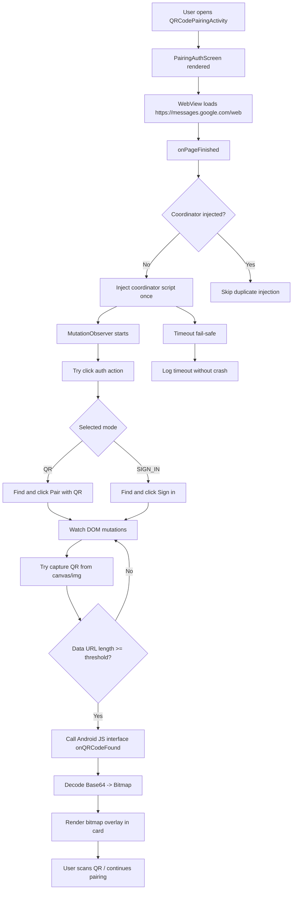
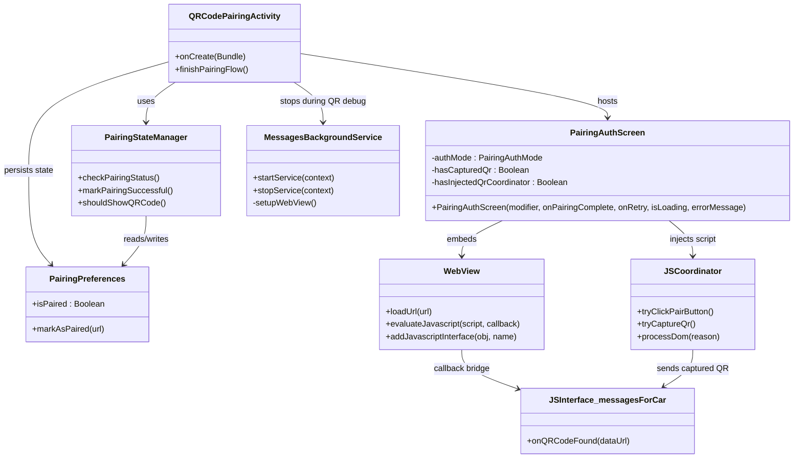

# MessagesForCar

An Android Automotive messaging application that brings Google Messages for Web to your car with automotive-specific optimizations and voice control features.

## Features

### 🚗 **Automotive Integration**
- Native Android Automotive Car App interface
- Optimized for in-vehicle use with larger touch targets
- Driving state awareness for safety compliance

### 🗣️ **Voice Messaging**
- Speech-to-text message composition
- Voice activation for hands-free operation
- Real-time speech recognition feedback

### 🌐 **Web Integration**
- Seamless Google Messages for Web integration
- QR code pairing with your phone (when parked)
- Synchronized messaging across devices

### 🛡️ **Safety First**
- Restricted functionality while driving
- QR code setup only available when parked
- Distraction-free interface design

## Installation

### Requirements
- Android Automotive OS device
- Android 10+ (API level 29)
- Microphone permission for voice features
- Internet connection

### Building from Source
1. Clone the repository
2. Open in Android Studio
3. Sync project with Gradle files
4. Build and install on your automotive device

```bash
./gradlew assembleDebug
```

## Usage

### Initial Setup
1. Install the app on your Android Automotive device
2. When parked, open the app and go to Setup
3. Follow the QR code pairing instructions
4. Scan the QR code with Google Messages on your phone

### Voice Messaging
1. Use the "Voice Message" button in the Car App interface
2. Speak your message clearly
3. Review and send, or try again

### Touch Interface
- Available when vehicle is parked
- Full Google Messages for Web functionality
- Optimized for automotive displays

## Development

### Architecture
- **UI Layer**: Jetpack Compose + Android Views (WebView)
- **Automotive Layer**: Android Car App Library
- **Voice Layer**: Android Speech Recognition APIs
- **Web Layer**: WebView with JavaScript injection

### Key Components
- `MainActivity`: Main messaging interface with WebView
- `VoiceActivity`: Voice input and speech recognition
- `MessagingCarAppService`: Android Automotive Car App service
- `MessagingWebView`: Customized WebView for Google Messages
- `PairingAuthScreen`: Dual-mode pairing/auth screen (QR + account sign-in)

### Pairing Flow Diagrams

#### Pairing/Auth Flow (Sequence)



#### Pairing/Auth Class Diagram



### Security Features
- Domain-restricted WebView navigation
- Sensitive data exclusion from backups
- Proper permission handling
- Secure authentication state management

## Configuration

### Permissions
The app requires the following permissions:
- `INTERNET`: For web messaging functionality
- `RECORD_AUDIO`: For voice messaging features
- `FOREGROUND_SERVICE`: For Car App service

### Automotive Features
- Declared as automotive-required application
- Car App service for native automotive interface
- Messaging category for proper system integration

## Contributing

1. Fork the repository
2. Create a feature branch
3. Follow the coding guidelines in `.github/copilot-instructions.md`
4. Test on automotive hardware when possible
5. Submit a pull request

## Privacy

MessagesForCar acts as a wrapper around Google Messages for Web. All message data is handled by Google's servers according to their privacy policy. The app does not store or transmit message content independently.

## License

This project is licensed under the MIT License - see the LICENSE file for details.

## Disclaimer

This app is designed for use in vehicles and must comply with local laws and regulations regarding driver distraction. Always prioritize road safety and use voice features when possible while driving.
